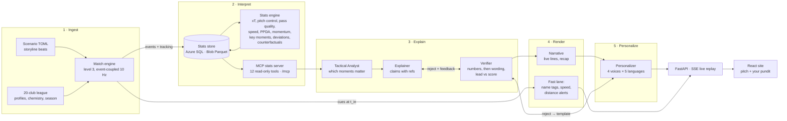
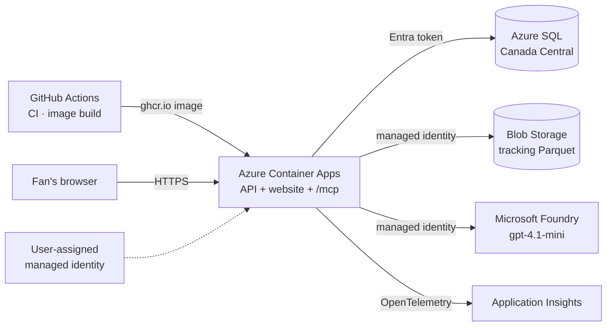

# MatchMind architecture

MatchMind turns synthetic football events into explainable, verified, personalized match intelligence. It has five parts:
1. **A match engine** writes events and 10 Hz tracking.
2. **A stats engine** turns them into numbers and key moments.
3. **An MCP server** serves those numbers.
4. **A team of Agent Framework agents on Microsoft Foundry** explains the moments, checks every claim, and writes them for each fan.
5. **A FastAPI service and React site** stream the match and the insights side by side.

Deep dives live in the [wiki](../wiki/README.md).

## The pipeline (the hackathon's five stages)

## Two lanes

- **Fast lane (overlays):** name tags plus speed and distance alerts are computed by code when the match is built. The live stream sends each one at its exact time (`t_in`), with no model in the path. Tested to arrive within 1 s.
- **Insight lane (agents):** the Analyst, Explainer, Verifier, Narrative, and Personalizer run before the match is served (the precompute), so viewers never wait on a model. "Ask the pundit live" runs the same agents on demand for one moment (about 30 s, rate-limited).

## The agents (Microsoft Agent Framework on Foundry `gpt-4.1-mini`)

| Agent | Job | Guardrail |
|---|---|---|
| Tactical Analyst | Picks which moments to explain, and at what level (game, team, player) | Must look up a moment's stats (MCP) before surfacing it |
| Explainer | Writes the insight: headline, why, recommendation, and claims, each with a stats `ref` and the cited events | Temperature 0; at most 8 key events |
| Verifier | Recomputes every number from its `ref` (deterministic), checks that lead wording matches the score, then has the model judge the wording against the cited events | Fails closed; up to 2 regenerations with feedback, then a deterministic template |
| Narrative | Live lines (≤ 140 characters) and the full-time recap | Numbers must be cited claims or real minutes and scorelines |
| Personalizer | The same insight for an analyst, a casual fan, a club's fan, and a player follower, in English, Spanish, Portuguese, French, and Arabic | Checked again in each language; failures get the template |

The agents share state through the stats store and reach numbers only through the MCP tools. A Microsoft Agent Framework workflow (`agents/orchestrator.py`) runs them per 5-minute window: `analyst → explainer_verifier → narrative → personalizer_verifier`.

Failures degrade to templates, never to errors:
- **Transient errors:** 429s and timeouts are retried with backoff (1, 2, 4 s).
- **Malformed replies:** regenerated.
- **Failed checks:** replaced by deterministic templates built only from verified claims.

Every call is logged with its tokens and traced to Application Insights.

## On Azure

- **One identity, no keys:** the managed identity reads Blob Storage, signs in to Azure SQL with an Entra token, and calls Foundry. There are no API keys or passwords anywhere.
- **Infrastructure as code:** `infra/*.bicep`, applied with `azd provision`. There's a budget with alerts at $25 and $50.
- **Images:** built by GitHub Actions, then deployed with `az containerapp update`.
- **Why it looks like this:** Azure for Students allows only five regions, has no ACR builds, and North Central US stopped accepting new SQL servers. See [the plan's Task 24 "As built"](superpowers/plans/2026-10-21-matchmind.md) and [`wiki/infra-ops.md`](../wiki/infra-ops.md).

## Data

Everything is synthetic, so no real match data is used:
- **League:** 20 fictional Colombian barrio clubs with generated squads.
- **Season:** a simulated season history.
- **Matches:** 8 showcase matches driven by storyline scenarios (`scenarios/*.toml`).

The engine is checked against professional ranges ([realism report](realism.md): all 18 checks pass over 20 seeds).
